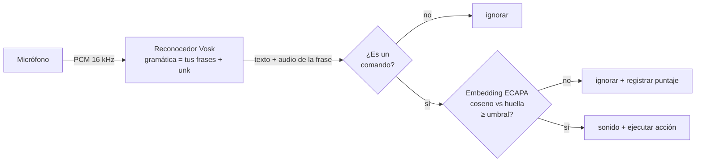

# VozClave

**Comandos de voz offline para tu computador que solo obedecen tu voz.**

[](https://github.com/jdmahecha1/vozclave/actions/workflows/ci.yml)


[Read in English](README.md)

Dices *"abre spotify"* y se abre Spotify. Lo dice otra persona y no pasa nada.
VozClave escucha las frases que tú definas, comprueba que la voz sea la tuya y entonces
abre una aplicación, una página o un archivo, cierra un programa o ejecuta un comando.
Todo funciona **en tu equipo**: el audio nunca sale de él.

```text
$ vozclave run        # salida de ejemplo
21:04:12  listening for: "abre el navegador", "pon música", "cierra spotify", ...
21:04:20  "pon música" -> music (voice match 0.68)
21:05:02  "cierra spotify" ignored: not your voice (voice match 0.12)
21:05:09  "cierra spotify" -> close music (voice match 0.71)
```

## Características

- **Verificación de hablante**: una huella de voz creada con tus propias grabaciones
  (embeddings neuronales ECAPA-TDNN) protege cada comando.
- **Reconocimiento de voz offline** con [Vosk](https://alphacephei.com/vosk/), limitado a tus
  frases: cualquier otra conversación se clasifica como "desconocida" en vez de disparar algo.
- **Configuración sencilla en TOML**: frases → acciones `open` / `close` / `run`.
- **`vozclave check`** avisa de palabras que el modelo no conoce (nunca se reconocerían),
  frases repetidas y archivos que no existen.
- Sonido de confirmación con volumen ajustable y tiempo de espera por comando.
- Español por defecto; también modelos en inglés, portugués y francés.

## Cómo funciona



1. **Reconocimiento.** El reconocedor solo elige entre tus frases y un token especial
   `[unk]`. Limitar el vocabulario lo hace mucho más preciso que el dictado libre y vuelve
   inofensivas las conversaciones que no tienen nada que ver.
2. **Verificación.** El audio exacto de la frase reconocida se convierte en un vector de
   192 dimensiones con el modelo
   [ECAPA-TDNN](https://huggingface.co/speechbrain/spkrec-ecapa-voxceleb) de SpeechBrain. Tu
   huella de voz es el promedio de tus grabaciones de registro; el comando solo se ejecuta si
   la similitud coseno supera `voice.threshold`.
3. **Acción.** `open` usa el programa predeterminado del sistema (apps, URLs, archivos, URIs
   como `spotify:`, apps de Microsoft Store), `close` cierra procesos por nombre con `psutil`
   y `run` ejecuta un comando **sin shell**, así una frase nunca puede inyectar otros comandos.

## Inicio rápido

```bash
pip install "vozclave[voiceid] @ git+https://github.com/jdmahecha1/vozclave"
vozclave download-model es   # modelo de voz offline de ~40 MB
vozclave init                # crea tu archivo de configuración
vozclave check               # valida tus frases contra el modelo
vozclave enroll              # di tus frases 8 veces para crear tu huella de voz
vozclave run
```

> Sin el extra `[voiceid]` (que instala PyTorch), pon `voice.enabled = false` y VozClave
> funciona como un lanzador por voz normal.

## Configuración

`vozclave init` copia [la configuración de ejemplo](src/vozclave/example_config.toml) a
`%APPDATA%\vozclave\config.toml` (Windows) o `~/.config/vozclave/config.toml`.
Un `vozclave.toml` en la carpeta actual tiene prioridad.

| Comando | Qué hace |
| --- | --- |
| `vozclave init` | Crea una configuración a partir del ejemplo |
| `vozclave download-model [es\|en\|pt\|fr]` | Descarga el modelo de voz offline |
| `vozclave check` | Valida configuración, frases y archivos |
| `vozclave devices` | Lista los micrófonos (usa el número en `input_device`) |
| `vozclave enroll [-n 8]` | Graba tu voz y crea tu huella |
| `vozclave run [-v]` | Empieza a escuchar |

### Ajustar el umbral

`vozclave run` registra el puntaje de similitud de cada intento. Di tus frases varias veces,
pídele a otra persona que lo intente y pon el umbral entre ambos grupos de puntajes.

## Privacidad

- El audio se procesa en memoria y nunca se guarda ni se envía a ningún lado.
- Solo se registran las frases reconocidas; todo lo demás se descarta.
- La huella de voz son 192 números guardados en tu carpeta de usuario (no el audio).

## Limitaciones

Es una cerradura de comodidad, **no una medida de seguridad**: una grabación de tu voz puede
engañarla y voces parecidas (hermanos) pueden sacar puntajes cercanos al tuyo. No la uses
para proteger nada sensible.

## Desarrollo

```bash
git clone https://github.com/jdmahecha1/vozclave && cd vozclave
python -m venv .venv && .venv/Scripts/activate   # source .venv/bin/activate en Linux/macOS
pip install -e ".[dev]"
pytest
ruff check . && ruff format --check .
```

Las pruebas no necesitan micrófono, modelo de voz ni PyTorch: el reconocimiento, la
verificación y el control de procesos se inyectan o simulan, así que la CI corre en Windows y
Linux en segundos.

## Licencia

[MIT](LICENSE) © Juan Diego Mahecha Martinez. Hecho con ayuda de Claude (Anthropic).
