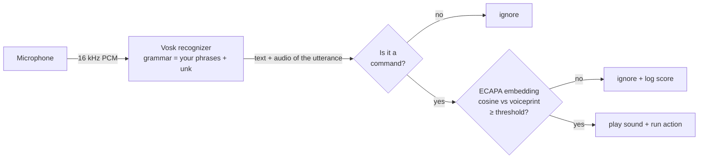

# VozClave

**Offline voice commands for your desktop that only obey your voice.**

[](https://github.com/jdmahecha1/vozclave/actions/workflows/ci.yml)


[Leer en español](README.es.md)

Say *"abre spotify"* and Spotify opens. Your roommate says it and nothing happens.
VozClave listens for the phrases you define, checks that the voice is yours, and then
opens an app, a URL or a file, closes a program, or runs a command. Everything runs
**on your machine**: no audio ever leaves it.

```text
$ vozclave run        # example output
21:04:12  listening for: "abre el navegador", "pon música", "cierra spotify", ...
21:04:20  "pon música" -> music (voice match 0.68)
21:05:02  "cierra spotify" ignored: not your voice (voice match 0.12)
21:05:09  "cierra spotify" -> close music (voice match 0.71)
```

## Features

- **Speaker verification**: a voiceprint built from your own samples (ECAPA-TDNN neural
  embeddings) gates every command.
- **Offline speech recognition** with [Vosk](https://alphacephei.com/vosk/), restricted to
  your phrases so random conversation is classified as "unknown" instead of misfiring.
- **Simple TOML config**: phrases → `open` / `close` / `run` actions.
- **`vozclave check`** warns about words the speech model doesn't know (they would silently
  never match), duplicated phrases and missing files.
- Confirmation sound with adjustable volume, per-command cooldown.
- Spanish by default; English, Portuguese and French models available.

## How it works



1. **Recognition.** The recognizer only chooses between your phrases and a special `[unk]`
   token. Restricting the vocabulary makes it far more accurate than free dictation and
   makes unrelated speech harmless.
2. **Verification.** The audio of the exact utterance that matched is converted into a
   192-dimensional embedding with SpeechBrain's
   [ECAPA-TDNN](https://huggingface.co/speechbrain/spkrec-ecapa-voxceleb) model. Your
   voiceprint is the average embedding of your enrollment samples; the command only runs if
   the cosine similarity is above `voice.threshold`.
3. **Action.** `open` uses the OS default handler (apps, URLs, files, `spotify:` URIs,
   Microsoft Store apps), `close` kills processes by name with `psutil`, and `run` starts a
   command line **without a shell**, so a phrase can never inject extra commands.

## Quick start

```bash
pip install "vozclave[voiceid] @ git+https://github.com/jdmahecha1/vozclave"
vozclave download-model es   # ~40 MB offline speech model
vozclave init                # creates your config file
vozclave check               # validates phrases against the model
vozclave enroll              # say your phrases 8 times to build your voiceprint
vozclave run
```

> Without the `[voiceid]` extra (which installs PyTorch), set `voice.enabled = false` and
> VozClave works as a plain voice launcher.

## Configuration

`vozclave init` copies [the example config](src/vozclave/example_config.toml) to
`%APPDATA%\vozclave\config.toml` (Windows) or `~/.config/vozclave/config.toml`.
A `vozclave.toml` in the current folder takes precedence.

```toml
[voice]
enabled = true
threshold = 0.40   # raise it if other people trigger commands

[sound]
file = "default"   # or a path to a .wav/.mp3/.flac, or "" for silence
volume = 0.3

[[commands]]
name = "music"
phrases = ["pon música", "abre spotify"]
action = "open"
target = "spotify:"

[[commands]]
name = "close music"
phrases = ["cierra spotify"]
action = "close"
target = "Spotify"
```

| Command | What it does |
| --- | --- |
| `vozclave init` | Create a config from the example |
| `vozclave download-model [es\|en\|pt\|fr]` | Download the offline speech model |
| `vozclave check` | Validate config, phrases and files |
| `vozclave devices` | List microphones (use the number in `input_device`) |
| `vozclave enroll [-n 8]` | Record your voice and build your voiceprint |
| `vozclave run [-v]` | Start listening |

### Tuning the threshold

`vozclave run` logs the similarity score of every attempt. Say your phrases a few times,
ask someone else to try, and put the threshold between both groups of scores.

## Privacy

- Audio is processed in memory and never stored or sent anywhere.
- Only matched phrases are logged; everything else is discarded.
- The voiceprint is a list of 192 numbers saved in your user folder (not the audio).

## Limitations

This is a convenience lock, **not a security boundary**: a recording of your voice can fool
it, and similar voices (siblings) may score close to yours. Don't use it to protect anything
sensitive.

## Development

```bash
git clone https://github.com/jdmahecha1/vozclave && cd vozclave
python -m venv .venv && .venv/Scripts/activate   # source .venv/bin/activate on Linux/macOS
pip install -e ".[dev]"
pytest
ruff check . && ruff format --check .
```

The tests don't need a microphone, the speech model or PyTorch: recognition, verification
and process control are injected or mocked, so CI runs on Windows and Linux in seconds.

```text
src/vozclave/
├── cli.py        # argparse subcommands
├── config.py     # TOML loading and validation
├── matcher.py    # phrase -> command, grammar for the recognizer
├── listener.py   # microphone -> utterances (text + audio)
├── speaker.py    # ECAPA embeddings, voiceprint, verification
├── engine.py     # decision logic: match -> cooldown -> verify -> act
├── actions.py    # open / close / run
├── sound.py      # confirmation sound
└── models.py     # Vosk model download
```

## Roadmap

- [ ] Start automatically with the system (`vozclave install-startup`)
- [ ] Tray icon with pause/resume
- [ ] Re-enroll incrementally to adapt to the user's voice over time

## License

[MIT](LICENSE) © Juan Diego Mahecha Martinez. Built with the help of Claude (Anthropic).
